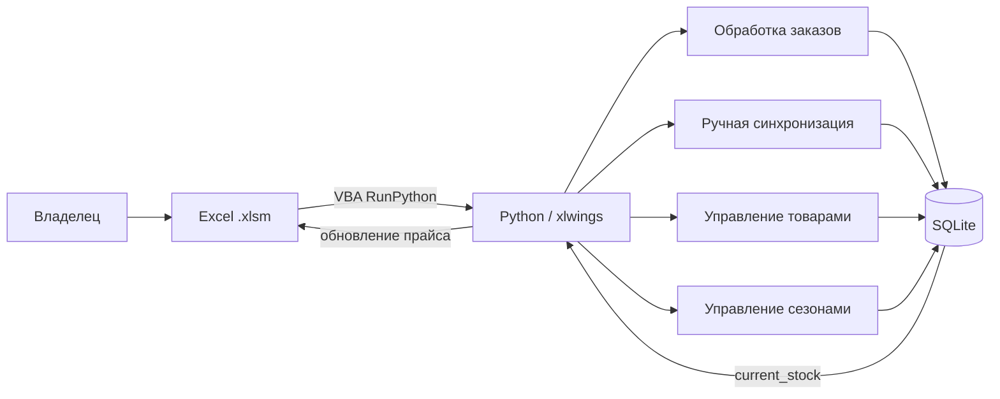

# Автоматизация учёта товаров и заказов

Проект для ведения товарного учёта товаров малого бизнеса. По просьбе владельца бизнеса Excel-файл является интерфейсом, а Python-модули синхронизируют операции с локальной SQLite-базой, поддерживают согласованность остатков и сохраняют историю изменений.

## Что уже реализовано

- SQLite-модель товаров, заказов, поступлений, инвентаризаций, движений товара и сезонов;
- обработка заказов из листов Excel: запись заказа и позиций в БД, обновление остатков и прайс-листа;
- синхронизация ручных изменений товара, поступлений и остатков с фиксацией истории;
- добавление, отключение и восстановление товаров;
- резервное копирование Excel и откат данных БД при ошибке синхронизации;
- журналирование операций;
- сценарий закрытия сезона: проверка Excel против БД, создание архивной и новой `.xlsm`-копии, открытие нового сезона и фиксация стартовых остатков.

## Архитектура



Подробности: [требования](docs/requirements.md), [архитектура](docs/architecture.md), [модель данных](docs/data-model.md), [интерфейсы](docs/api-design.md).

## Стек

Python, SQLite, Excel/VBA, xlwings.

## Статус и развитие

REST API, Telegram-бот и LLM/RAG-интеграция **не реализованы** в текущем коде. Это возможные направления развития, а не существующие возможности проекта.

## Структура

```text
inventory_app/
  core/               # подключение к БД, конфигурация, логирование, откат Excel
  excel/              # чтение данных Excel
  orders/             # проведение, удаление и восстановление заказов
  manual_changes/     # синхронизация товаров, поступлений и остатков
  products/           # добавление, отключение и восстановление товаров
  season_management/  # проверка и смена сезона
docs/                 # проектная документация
CloseSeason.bas       # VBA-макрос запуска закрытия сезона
```

