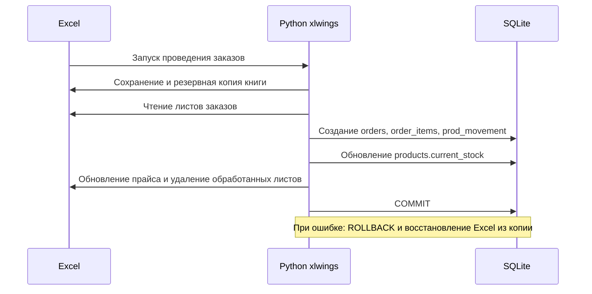

# Архитектура

## Компоненты

| Компонент | Ответственность |
| --- | --- |
| Excel `.xlsm` | Рабочий интерфейс: прайс, листы заказов, лист добавления товаров, макросы. |
| VBA | Запускает Python-функции из Excel. В частности, `CloseSeason.bas` запрашивает подтверждение и вызывает `season_service.main()`. |
| `inventory_app.excel` | Чтение и валидация данных из Excel через `xlwings`. |
| `inventory_app.orders` | Проведение, отключение и восстановление заказов; отражение результата в Excel. |
| `inventory_app.manual_changes` | Синхронизация атрибутов товаров, поступлений и инвентаризационных изменений. |
| `inventory_app.products` | Добавление, отключение и восстановление товарных позиций. |
| `inventory_app.season_management` | Валидация данных и безопасная смена сезона. |
| SQLite | Локальное хранилище товаров, операций, истории, сезонов и стартовых остатков. |

## Сценарий проведения заказа

## Смена сезона

Модуль сезона валидирует рабочую книгу против активного сезона, создаёт неизменяемый архив и копию для нового сезона, записывает новый активный сезон и стартовые остатки, затем заново рассчитывает «Наличие». По коду операции SQLite выполняются транзакционно; файловая часть подготавливается до подтверждения БД.

## Границы системы

Текущая система является локальным desktop-решением. Межсистемного HTTP-взаимодействия нет; связь Excel и Python реализована через `xlwings` и VBA.
