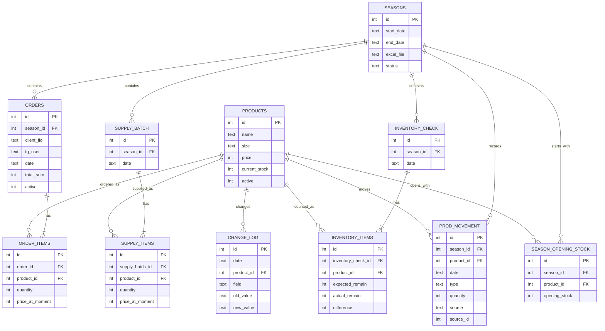

# Модель данных

Ниже отражена физическая SQLite-схема, используемая приложением. Поля приведены в сокращённом виде; источник истины — `inventory_app/core/database.py`.

## Ключевые ограничения

- `season_opening_stock` уникален по паре `(season_id, product_id)`.
- `supply_items` уникальны по паре `(supply_batch_id, product_id)`.
- `inventory_items` уникальны по паре `(inventory_check_id, product_id)`.
- Частичный уникальный индекс не допускает более одного `seasons.status = 'active'`.
- Активные товары уникальны по сочетанию названия и размера.
